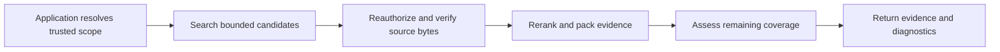

<div align="center">

# Cragkit

**Native Python & TypeScript retrieval library**

Source-linked evidence · Coverage estimates · Bounded retrieval · Execution diagnostics

[](packages/python)
[](packages/typescript)
[](#current-status)
[](LICENSE)

</div>

---

Cragkit helps applications retrieve useful passages from their documents and return
those passages with source references, coverage estimates and execution diagnostics.
Use it in document-backed assistants, RAG pipelines and agent tools when the caller
needs to inspect what evidence was found, what is missing and whether a fallback ran.

The Python and TypeScript packages execute natively in the consuming application.
The Node package does not require a Python server. PostgreSQL and Qdrant are optional
backend integrations; LangChain and MCP are separate optional packages.

Your application supplies authentication, trusted access scope, source data and any
model clients. Cragkit returns evidence; your application decides whether to answer,
abstain, ask a follow-up question or pass that evidence to a model.

> [!IMPORTANT]
> The prepared package versions are release candidates: Python `1.0.0rc3` and npm
> `1.0.0-rc.2`. Publication is pending; see the roadmap for live release status. Review the
> [release notes](docs/releases/V6.md) for the tested scope and limitations.
> MIT covers the project code; model-provider usage and hosting have separate terms and costs.

## What Cragkit Does

| Feature | What it provides |
|---|---|
| Text ingestion | Canonical Markdown/plain-text revisions, bounded chunks, digests and explicit generation publication |
| PostgreSQL search | Native full-text search, exact vector search, identifiers and hybrid rank fusion |
| Qdrant search | Profile-checked vector candidates with an authoritative source/access boundary |
| Reranking | Optional bounded relevance ordering through an application-supplied transport |
| Corrective retrieval | Budgeted planning/retry decisions that preserve scope, required filters and deadlines |
| Evidence packing | Exact source excerpts, UTF-8 byte spans, context budgets and optional strict token counting |
| Coverage assessment | Supported, missing, unknown or conflicting facets and explicit limitations |
| Lifecycle operations | Controlled reindexing, revocation, tombstones and backend publication/recovery paths |
| Integrations | Native LangChain tools and an application-configured MCP host |
| Diagnostics | Typed errors, usage accounting, cancellation and privacy-controlled events |

Cragkit fits backend applications that want control over their stores, access policy
and model clients. It does not supply authentication, a crawler, PDF/OCR ingestion,
a hosted chat interface or final-answer verification; add those at the application
boundary when needed.

The retrieval flow is:



Search does not establish that a source is true. PostgreSQL native FTS is not BM25.
A good similarity score alone does not prove that every part of a question is answered.
Required access filters survive search, reranking, corrective attempts and source release.

## Current Status

| Package or capability | Published version / scope | Status | Guide |
|---|---|---|---|
| Python / Node core `cragkit` | `1.0.0rc3` / `1.0.0-rc.2` | Python RC3 pending; npm RC2 published | [API reference](docs/api-reference.md) |
| `cragkit-langchain` | Python RC3 / npm RC2 | Optional integration | [LangChain](docs/integrations/langchain.md) |
| `cragkit-mcp` | Python RC3 / npm RC2 | Optional stdio host | [Host API](docs/api-reference.md#mcp-packages) |
| PostgreSQL / pgvector | Native FTS and exact-vector profiles | Explicit database setup | [Storage](storage/postgres/README.md) |
| Qdrant | Declared single-node candidate/publication profiles | Optional backend | [Qdrant setup](docs/integrations/qdrant.md) |
| Public source checks | Types, builds, archives and fresh installed imports | Available without private workbench | [Development](docs/development.md) |

> [!NOTE]
> Local and recorded release checks cover declared environments and small bounded
> workloads. They do not establish general model quality, all-platform compatibility
> or production acceptance for your deployment. The [release notes](docs/releases/V6.md)
> keep these boundaries separate. Current maintenance work is in the [roadmap](docs/roadmap.md).

## Quick Start

### Prerequisites

Install only the runtime needed by your application:

| Application | Required runtime | Optional dependencies |
|---|---|---|
| Python | Python `>=3.14,<3.15` | PostgreSQL, Qdrant and tokenizer extras as needed |
| JavaScript / TypeScript | Node.js `>=26.5.0,<27` | Matching optional `pg` / `tiktoken` peers as needed |
| Contributor checkout | The relevant runtime; uv and npm for repository checks | See [development setup](docs/development.md) |

Recorded checks used Python 3.14.6, Node 26.5.0, npm 11.17.0 and uv 0.11.8.
Installing the core package does not start a database, download a model or apply migrations.

### Install in an application

Python, in a new virtual environment:

```sh
python3.14 -m venv .venv
. .venv/bin/activate
python -m pip install 'cragkit==1.0.0rc3'
```

Node, from your application's directory:

```sh
npm init -y
npm install 'cragkit@1.0.0-rc.2'
```

Select optional integrations explicitly:

| Need | Python | Node |
|---|---|---|
| PostgreSQL driver | `python -m pip install 'cragkit[postgres]==1.0.0rc3'` | `npm install 'pg@8.23.1'` |
| Qdrant HTTP dependency | `python -m pip install 'cragkit[qdrant]==1.0.0rc3'` | Provide a Node HTTP transport; see the Qdrant guide |
| Strict tokenizer support | `python -m pip install 'cragkit[tokenizers]==1.0.0rc3'` | `npm install 'tiktoken@1.0.22'` |
| LangChain tool | `python -m pip install 'cragkit-langchain==1.0.0rc3'` | `npm install 'cragkit-langchain@1.0.0-rc.2'` |
| MCP host | `python -m pip install 'cragkit-mcp==1.0.0rc3'` | `npm install 'cragkit-mcp@1.0.0-rc.2'` |

Strict counting also requires the explicitly acquired, pinned local tokenizer asset.
An installed tokenizer dependency alone does not configure that asset or a final model wrapper.

Cragkit has **no shared API key** and does not automatically read `.env` files.
Your backend may load its own `.env` or secret-manager configuration and inject a
provider transport. Lexical PostgreSQL retrieval needs no embedding or reranker API key.
Keep database passfiles, provider keys and trusted scope outside model-facing tool input.

### Verify installation without a database

The root imports expose the package version. Feature APIs live in named modules.
These two examples validate a request and an illustrative scope without opening a connection.

Python:

```python
from cragkit.contracts import parse_request, parse_scope

request = parse_request({
    "query": "What is the retry limit?",
    "collection": "handbook",
})
scope = parse_scope({
    "tenant_id": "example-tenant",
    "principal_id": "example-reader",
    "authorization_revision": "scope-1",
    "grant_ids": [],
})
print(request.collection, scope.principal_id)
```

Node, saved as `check.mjs` and run with `node check.mjs`:

```javascript
import { parse_request, parse_scope } from 'cragkit/contracts';

const request = parse_request({
  query: 'What is the retry limit?',
  collection: 'handbook',
});
const scope = parse_scope({
  tenant_id: 'example-tenant',
  principal_id: 'example-reader',
  authorization_revision: 'scope-1',
  grant_ids: [],
});
console.log(request.collection, scope.principal_id);
```

Both print `handbook example-reader`. In a real application, derive scope from
an authenticated session and current authorization state. Never accept tenant or grant
values directly from an untrusted request merely because they pass schema validation.

### Retrieve from PostgreSQL

First provision the schema, a bounded least-privilege reader role and authorized
source data using the [database guide](storage/postgres/README.md) and
[secure connection guide](docs/neon.md). Administrative setup is separate from runtime
retrieval. The snippets below search the keyword `retry` in an existing collection;
they do not create tables or grants. Dense or hybrid mode adds the configured
embedding-based search path for semantic queries.

Have your application provide `APP_DB_HOST`, `APP_DB_NAME`, `APP_DB_USER`,
`APP_DB_CA_FILE` and `APP_DB_PASSFILE`; `APP_DB_PORT` is optional and defaults to 5432.
The two file paths must be absolute;
the passfile must be owner-only and contain the exact endpoint/login entry.
Use a deployment-supported trusted CA. Do not put the password in these snippets.

Python:

```python
import asyncio
import os
from pathlib import Path

from cragkit.contracts import RetrievalRequest, TrustedScope
from cragkit.postgres import PoolConfig, PoolResource, PostgresRetriever


async def retrieve_handbook(scope: TrustedScope):
    resource = PoolResource(PoolConfig(
        host=os.environ["APP_DB_HOST"],
        port=int(os.environ.get("APP_DB_PORT", "5432")),
        dbname=os.environ["APP_DB_NAME"],
        user=os.environ["APP_DB_USER"],
        sslrootcert=Path(os.environ["APP_DB_CA_FILE"]),
        passfile=Path(os.environ["APP_DB_PASSFILE"]),
    ))
    await resource.open()
    try:
        retriever = PostgresRetriever(resource, mode="lexical")
        request = RetrievalRequest(
            query="retry", collection="handbook")
        return await retriever.retrieve(
            request, scope=scope,
            deadline=asyncio.get_running_loop().time() + 10,
        )
    finally:
        await resource.close()
```

TypeScript:

```typescript
import { PoolResource, parse_pool_config, PostgresRetriever, now } from 'cragkit/postgres';
import { parse_request, type TrustedScope } from 'cragkit/contracts';

async function retrieveHandbook(scope: TrustedScope) {
  const resource = new PoolResource(parse_pool_config({
    host: process.env.APP_DB_HOST,
    port: Number(process.env.APP_DB_PORT ?? '5432'),
    dbname: process.env.APP_DB_NAME,
    user: process.env.APP_DB_USER,
    sslrootcert: process.env.APP_DB_CA_FILE,
    passfile: process.env.APP_DB_PASSFILE,
  }));
  await resource.open();
  try {
    const retriever = new PostgresRetriever(resource, { mode: 'lexical' });
    return await retriever.retrieve(parse_request({
      query: 'retry', collection: 'handbook',
    }), { scope, deadline: now() + 10 });
  } finally {
    await resource.close();
  }
}
```

Call the function with your application-resolved trusted scope and inspect its returned
result as shown below. Deadlines are monotonic **seconds**, not Unix timestamps or
`Date.now()` milliseconds. Owned PostgreSQL resources reject ambient `PG*` settings;
use explicit configuration rather than mixing connection sources. Reuse a resource
for the application's lifetime in a server, and close it during shutdown. These compact
functions show an independently owned operation with cleanup.

For ingestion, construct `PostgresIndexer(writer_resource, authorize_write=...)` in
Python or its Node equivalent with a separate writer resource and application-owned
write authorizer. Its `ingest` operation canonicalizes input, stages an immutable
revision and publishes the validated generation. See the [API reference](docs/api-reference.md)
for the complete signature, intent replay rules and required authorization callback.

### Enable Qdrant or agent integrations

**Qdrant** is a vector database integration, not a single utility function. Its search
store returns candidate IDs and scores. The supported source store verifies current
access and immutable source bytes before text is exposed. A managed writer also needs
the selected authority schema, caller-owned supervisor, publication and recovery setup.

Use the [Qdrant guide](docs/integrations/qdrant.md) for installation, profile selection,
transport contracts, retrieval construction and shutdown. The [publication guide](docs/qdrant-publication.md)
covers managed indexing, repair and purge. Qdrant dense search does not provide
PostgreSQL lexical search or BM25.

For agent tools, install the matching optional package and follow
[LangChain setup](docs/integrations/langchain.md) or the
[MCP host reference](docs/api-reference.md#mcp-packages). The application supplies the
engine, trusted identity policy and final serializer. Installing `cragkit-mcp` does not
create an automatically configured standalone server.

### Run Local Checks

Contributors should fork or clone an accessible checkout, inspect existing changes,
and install the locked development dependencies described in [CONTRIBUTING.md](CONTRIBUTING.md).
From the repository root, the complete public package profile is:

```sh
python3 tools/check_public_packages.py --output-dir artifacts/public-check
```

Use a fresh output directory. The default uses populated offline caches;
`--allow-downloads` explicitly permits locked dependency downloads. This serial profile
checks types, builds all six packages, inspects nine archives and tests fresh installed
imports. The private maintainer regression suite is separate; contributors do not need
access to it to submit a reproduction or pull request.

📖 [Development commands](docs/development.md) · [CI behavior](docs/ci.md) · [Contribution process](CONTRIBUTING.md)

## Evidence Examples

A retrieval result keeps evidence quality separate from execution health:

| Field | How to use it |
|---|---|
| `status` | `sufficient`, `partial` or `insufficient`: the selected evidence assessment |
| `execution` | `complete` or `degraded`: whether an explicitly allowed fallback ran |
| `evidence` | Exact excerpts with source/revision identity, byte spans and digests |
| `facets` | Supported, missing, unknown or conflicting parts of the question |
| `context` | The packed representation for the consuming application/model |
| `limitations` | Explicit reasons such as unknown coverage, truncation or degraded search |
| `usage` / `versions` | Attempts, provider usage, context accounting and configuration identities |

Python result handling:

```python
result = await retrieve_handbook(authenticated_scope)
if result.execution == "degraded":
    print("An allowed fallback ran; inspect limitations.")
if result.status == "sufficient":
    context_for_application = result.context
elif result.status == "partial":
    context_for_application = result.context  # Also surface missing/unknown facets.
else:
    context_for_application = None
```

TypeScript result handling:

```typescript
const result = await retrieveHandbook(authenticatedScope);
if (result.execution === 'degraded') {
  console.log('An allowed fallback ran; inspect limitations.');
}
const contextForApplication = result.status === 'insufficient' ? null : result.context;
```

These are integration fragments: `authenticated_scope` / `authenticatedScope` come
from your application's identity layer. Default lexical retrieval reports `partial` when it returns useful
excerpts and `insufficient` when it finds none, with `coverage_unknown`. Configure a
suitable assessment policy before relying on `sufficient`. A provider timeout or
failed authorization store remains an operational error, not an empty successful result.

For a question asking for a retry rule and a delay, evidence for the retry rule alone
cannot establish the delay. A strict context budget may exclude otherwise relevant
passages. Exact excerpts establish source fidelity, not truth or answer correctness.

> [!NOTE]
> A hard token ceiling requires the declared tokenizer, the actual serialized
> representation and enough reserve for its wrapper. Estimated counting provides
> no hard guarantee. See [token context](contracts/TOKEN_CONTEXT_V3.md),
> [packing](contracts/PACKING_V3.md) and [assessment](contracts/ASSESSMENT_V3.md).

## Project Guide

The [complete API reference](docs/api-reference.md) lists public imports, functions,
classes, constructors and methods for both runtimes. Start with these entry points:

| Task | Public entry points | Responsibility |
|---|---|---|
| Validate boundaries | `parse_request`, `parse_tool_request`, `parse_scope`, `parse_result` | Reject malformed request, scope and result envelopes |
| Manage PostgreSQL connections | `PoolConfig` / `parse_pool_config`, `PoolResource.open/close` | Explicit bounded connections, verified TLS and ownership |
| Index text | `PostgresIndexer.ingest`, `PostgresVectorIndexer.ingest` | Authorized immutable source/vector generation workflows |
| Retrieve with PostgreSQL | `PostgresRetriever.retrieve` | Lexical, dense or hybrid candidates and source-linked evidence |
| Manage document lifecycle | `PostgresLifecycle` | Authorized generation and document lifecycle operations |
| Supply embeddings | `EmbeddingAdapter`, `EmbeddingProfile`, `EmbeddingLimits`, `EmbeddingPolicy` | Profile-bound query/batch vectors through an injected transport |
| Rerank candidates | `RerankingAdapter.rank`, `RerankProfile` | Bounded candidate ordering and usage accounting |
| Count and pack context | `Cl100kCounter`, `render_context`, `count_context`, `pack_evidence`, `pack_and_assess` | Exact declared counting, source-verified spans and final coverage |
| Assess evidence | `assess_evidence`, `validate_assessment` | Facet estimates under the configured policy |
| Execute corrective retrieval | `CorrectiveRetriever.retrieve` | Request-local bounded planning, search and recovery |
| Search Qdrant | `QdrantSearchStore.initialize/search_candidates/close` | Validate a selected replica profile and return text-free nominations |
| Authorize Qdrant sources | `PostgresQdrantSourceStore` | Read current authoritative revisions and access state |
| Retrieve with Qdrant | `QdrantCorrectiveBackend`, `CorrectiveRetriever` | Combine nominations, source checks, packing and corrective execution |
| Publish or repair Qdrant | `QdrantPublicationManager`, worker hosts and recovery interfaces | Stage, publish, recover and purge under the managed consistency contract |
| Expose a LangChain tool | `create_tool` | Bind trusted engine/scope/limits and serialize the final tool result |
| Host MCP | `RetrievalHost`, `create_server`, Node `BoundedStdioTransport` | Resolve identity outside tool input and serve the configured retrieval engine |

The reference separates runtime-specific names, model/schema types, public protocols
and implementation helpers. Do not substitute proposed architecture pseudocode for
actual imports or assume that Python-only low-level helpers are exported by the Node package.

<details>
<summary><strong>📐 Architecture & Design</strong></summary>

- [Architecture](docs/architecture/ARCHITECTURE.md) — Runtime boundaries and source/access contracts
- [Diagrams](docs/architecture/DIAGRAMS.md) — Retrieval, ingestion, data and authorization flows
- [API reference](docs/api-reference.md) — Actual function/class imports, signatures and lifecycle

</details>

<details>
<summary><strong>📋 Roadmap & Compatibility</strong></summary>

- [Current roadmap](docs/roadmap.md) — Maintenance scope and pending release decisions
- [RC1 notes](docs/releases/V6.md) — Supported profiles, recorded checks and material limitations
- [Migration and recovery](docs/migrations-and-recovery.md) — Explicit upgrades and safe restore boundaries

</details>

<details>
<summary><strong>📦 Packages & Contracts</strong></summary>

- [Shared contracts](contracts/README.md) — Request/result, source and backend behavior
- [Result contract](contracts/RESULTS.md) — Evidence, coverage and execution meanings
- [LangChain integration](docs/integrations/langchain.md) — Trusted binding and final message counting
- [Qdrant integration](docs/integrations/qdrant.md) — Dense retrieval and authority requirements

</details>

<details>
<summary><strong>🗄️ Backend Setup & Operations</strong></summary>

- [PostgreSQL storage](storage/postgres/README.md) — Migrations, least-privilege roles and schema profiles
- [Secure connection setup](docs/neon.md) — Explicit configuration, passfiles and verified TLS
- [Embedding profiles](docs/postgres-embedding-profiles.md) — Supported fake/live profile storage
- [Operations](docs/v5-operations.md) — Optional dependencies, ownership and shutdown
- [Qdrant publication](docs/qdrant-publication.md) — Managed publication, repair and purge
- [Production security](docs/production-security.md) — Application and deployment responsibilities

</details>

<details>
<summary><strong>🤝 Contributing & Support</strong></summary>

- [Contribution guide](CONTRIBUTING.md) — Setup, roles, branches, checks, issue and PR formats
- [Report a bug](.github/ISSUE_TEMPLATE/bug_report.yml) — Versions, synthetic reproduction and expected/actual behavior
- [Request a feature](.github/ISSUE_TEMPLATE/feature_request.yml) — Problem, scope, proposal and acceptance criteria
- [PR template](.github/pull_request_template.md) — Change summary, validation and compatibility review
- [Support scope](docs/support.md) — Safe diagnostics, triage and sensitive reports
- [Development checks](docs/development.md) — Public builds and private maintainer verification
- [Agent instructions](AGENTS.md) — Repository automation boundaries

</details>

> [!NOTE]
> Core imports do not perform migrations or network calls. Apply schema changes
> explicitly, keep administrative credentials out of runtime pools, and close the
> resources your application owns. See the [operations guide](docs/v5-operations.md).

## Repository

[Source](https://github.com/vsuman00/Cragkit) ·
[Issues](https://github.com/vsuman00/Cragkit/issues) ·
[Pull requests](https://github.com/vsuman00/Cragkit/pulls) ·
[Contributing](CONTRIBUTING.md) · [MIT license](LICENSE)

Repository access follows its current visibility settings. Registry installation is
independent of checkout access. Maintainers review behavioral changes, run the retained
regression checks and authorize releases separately; a merged PR does not itself publish
a package. See [release procedure](docs/releasing.md).
