# Cragkit architecture diagram catalog

Design baseline v0.1. All diagrams describe proposed behavior. SVG overview views are static and self-contained; Mermaid sources are editable. The full contracts and exceptions are in [ARCHITECTURE.md](ARCHITECTURE.md).

## System context and library boundaries

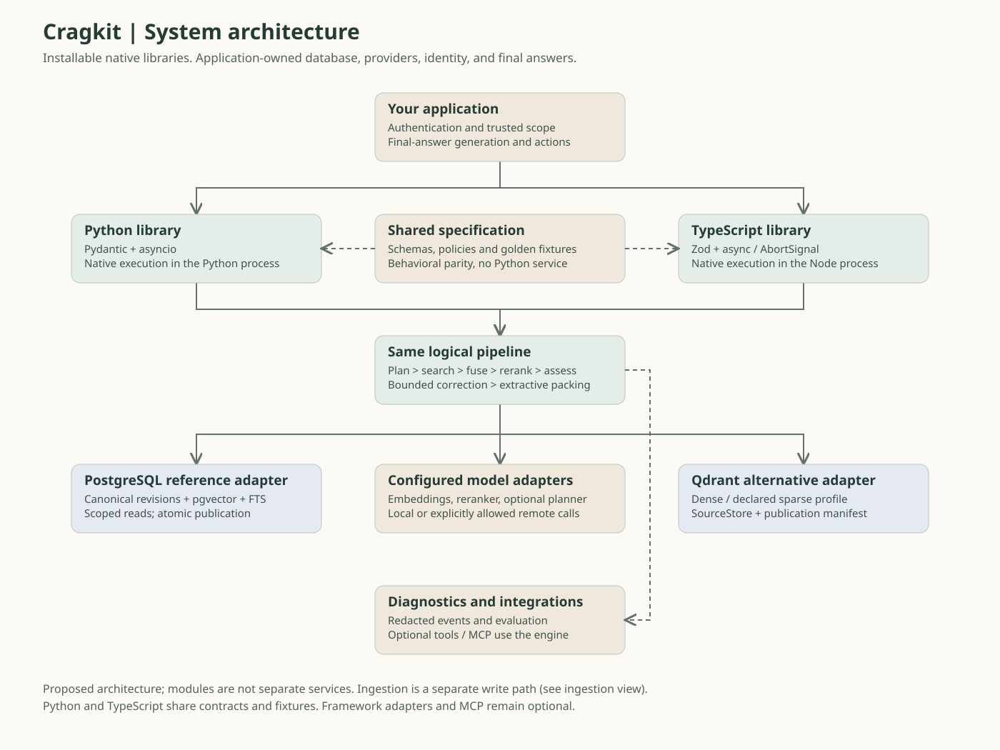

[Editable source](diagrams/01-system.mmd)

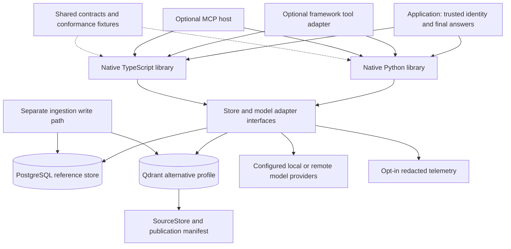

## Request state machine

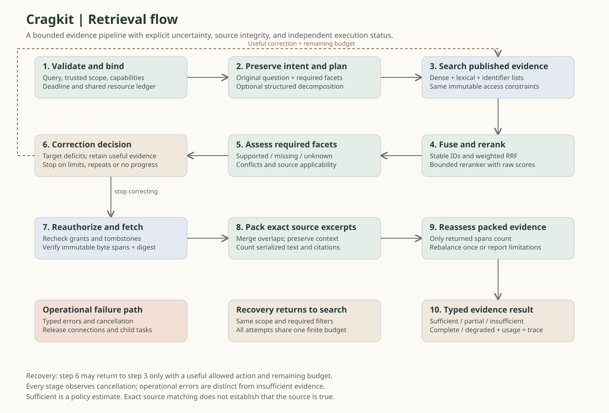

[Editable source](diagrams/02-retrieval.mmd)

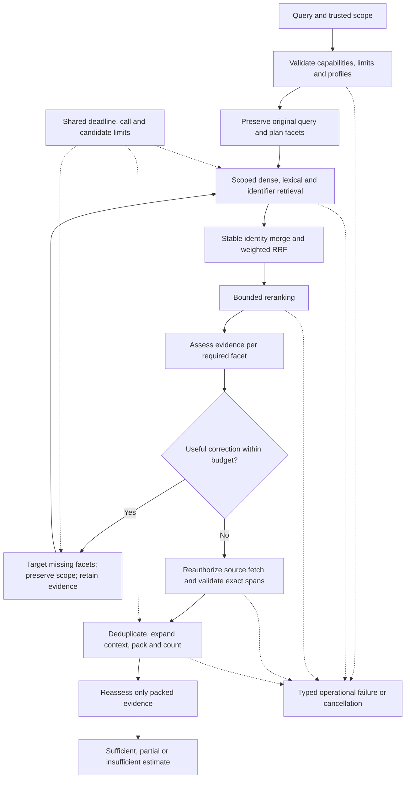

## Ingestion, updates and publication

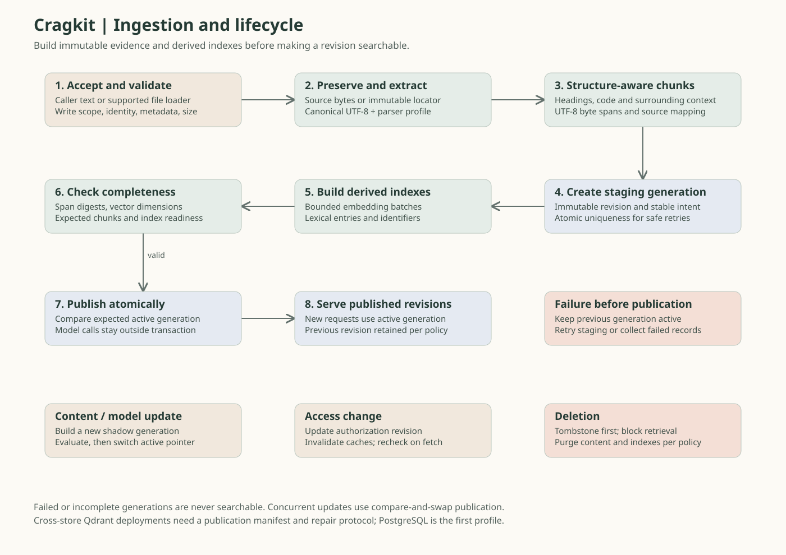

[Editable source](diagrams/03-ingestion.mmd)

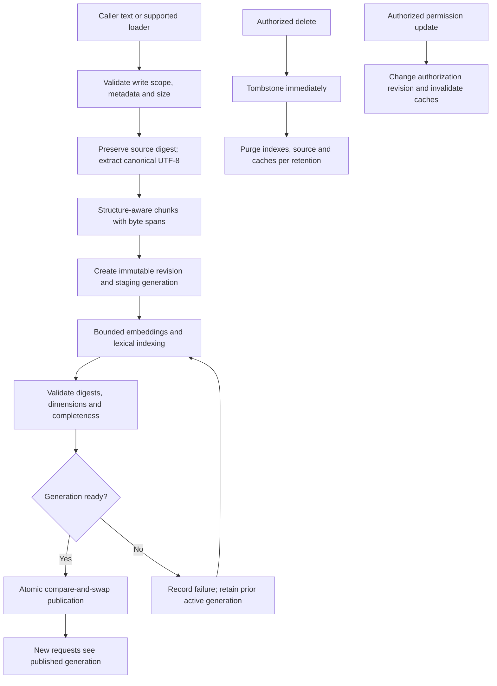

## Logical data relationships

[Editable source](diagrams/04-data-model.mmd)

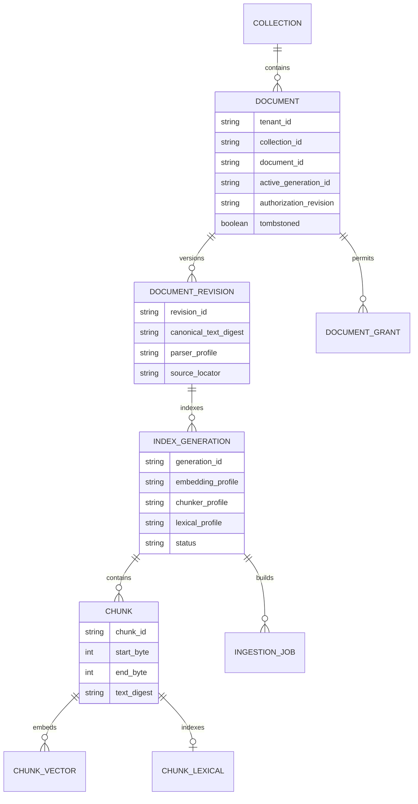

## Database connection and request sequence

[Editable source](diagrams/05-request-sequence.mmd)

```mermaid
sequenceDiagram
    participant App as Application
    participant Lib as Native library
    participant Pool as PostgreSQL pool
    participant DB as PostgreSQL
    participant Model as Model adapter
    App->>Lib: retrieve(request, trusted scope)
    Lib->>Lib: Validate and establish shared deadline
    Lib->>Model: Embed query under budget
    Model-->>Lib: Vector and profile
    Lib->>Pool: Acquire before deadline
    Pool-->>Lib: Connection
    Lib->>DB: Begin read transaction; bind scoped context
    Lib->>DB: Scoped candidate query, active generation snapshot
    DB-->>Lib: Ranked lists and immutable revision IDs
    Lib->>DB: End read transaction
    Lib->>Pool: Release connection
    Lib->>Lib: Merge and fuse
    Lib->>Model: Bounded rerank and optional assessment
    Model-->>Lib: Scores and facet estimates
    opt Useful correction with remaining budget
        Lib->>Lib: Rewrite missing facet; repeat bounded search
    end
    Lib->>Pool: Acquire for authorized source fetch
    Lib->>DB: Recheck grants/tombstones; fetch exact revision spans
    DB-->>Lib: Allowed evidence or revocation
    Lib->>Pool: Release in finally
    Lib->>Lib: Verify spans; pack; count; reassess
    Lib-->>App: Evidence result, limitations and usage
```

## Trust boundaries and provider disclosure

[Editable source](diagrams/06-authorization.mmd)

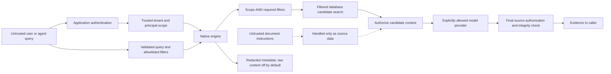

## Native runtime conformance

[Editable source](diagrams/07-parity.mmd)

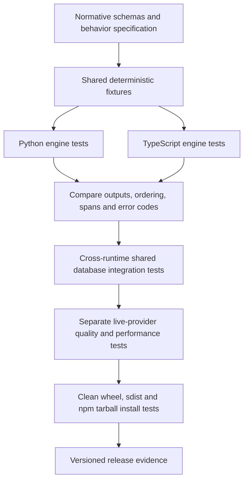

## Build dependency map

[Editable source](diagrams/08-phases.mmd)

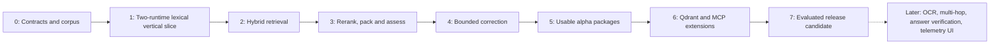

## Evidence quality and execution outcome

[Editable source](diagrams/09-result-policy.mmd)

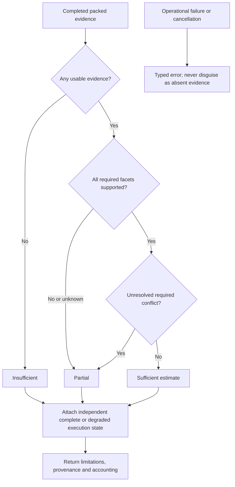
