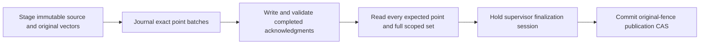

# Native Qdrant stage and publish

The optional Python module `cragkit.qdrant_publication` and Node subpath `cragkit/qdrant-publication` provide managed stage, publication, repair and current-security convergence. [In-process evidence](../evaluation/reports/V5/V5-04F2a2ii.md), [worker evidence](../evaluation/reports/V5/V5-04F2b.md) and [public convergence evidence](../evaluation/reports/V5/V5-04G2c.md) record their native checks. Purge and the complete fault matrix remain open; this module does not yet establish full QD-r1 compatibility.

For example, G1 remains active while G2 is staged, written and verified. Only the final SQL commit switches the active generation to G2. If that work fails first, G1 remains active.



## Dependencies and ownership

Applications supply two opened optional PostgreSQL resources: a restricted writer resource and a restricted supervisor resource. Install the declared authority schema explicitly. The application also initializes the supported native Qdrant supervisor with its owned binary, storage and registered profile. Manager construction and imports do not open resources, apply migrations, install models or start servers.

Construct a writer, its exact reconciliation verifier and recovery coordinator, then bind them in `PostgresQdrantPublicationAuthority(writer, recovery)`. Construct `ManagedQdrantPublicationTransport(supervisor)` with that same actual supervisor. Pass those objects, the complete QC-r1 configuration and your application's write authorizer to the five-argument manager.

The manager checks original dependency identities. Equivalent configuration does not make another verifier the issuer of a recovery receipt. The public module reexports native dependency classes for explicit construction; private receipt and proof accessors are not public API.

Given already opened resources, an initialized supervisor and the complete configuration:

```python
from cragkit.qdrant_publication import (
    ManagedQdrantPublicationTransport, PostgresQdrantPublicationAuthority,
    PostgresQdrantRecovery, PostgresQdrantWriter,
    QdrantPublicationManager, QdrantReconciliationVerifier,
)

writer = PostgresQdrantWriter(writer_resource, config, instance_id)
verifier = QdrantReconciliationVerifier(writer, supervisor)
recovery = PostgresQdrantRecovery(supervisor_resource, config, supervisor, verifier)
authority = PostgresQdrantPublicationAuthority(writer, recovery)
transport = ManagedQdrantPublicationTransport(supervisor)
manager = QdrantPublicationManager(authority, transport, config, supervisor, authorize_write)
await manager.initialize(deadline=deadline)

staged = await manager.stage(change, scope, stage_ledger, deadline=deadline)
published = await manager.publish(
    {"collection": collection, "document_id": document_id, "intent_id": intent_id},
    scope, publish_ledger, deadline=deadline,
)
await manager.close()
```

Node exposes the same classes and constructor order. Its methods take a final `{deadline, signal?}` options object. Python uses native task cancellation. Use the existing [optional PostgreSQL resource API](development.md) and [QW-r1 input specification](../contracts/QDRANT_PUBLICATION_V5.md) for complete configuration and stage shapes.

The application closes the borrowed transport, recovery coordinator, writer, resources and controller after managers finish. Manager close drains its operations and handles; it does not close those borrowed dependencies. The reconciliation verifier's own cleanup interface follows its runtime implementation.

## Input, authorization and budgets

Stage input includes the complete immutable source, revision, generation, manifest, original vectors and explicit initial authorization. Fake-profile arrays support routine synthetic tests. Real embedding profiles require already-computed bound E-r1 batches. The manager makes no embedding/model call.

Publish takes exactly `collection`, `document_id` and `intent_id`. Tenant identity comes from the separately supplied trusted scope. Caller input cannot provide an owner capability. The asynchronous authorizer receives that scope and target and must return a real boolean. It runs before admission, each new mutation and final publication, outside SQL transactions; current SQL fences remain authoritative afterward.

Each operation reserves at most one logical ledger attempt and charges zero model calls and candidates. Reusing an exhausted ledger cannot send a write. The supplied deadline and ledger deadline share the same operation budget. The manager admits one operation at a time without a queue.

## Outcomes and retries

Results have nine fields: `intent_id`, `operation`, `state`, `revision_id`, `generation_id`, `authority_committed`, `replica_complete`, `published` and `purge_complete`. Staged immutable records are durable while the publication flags remain false. A matching completed retry returns its historical outcome; it does not restore old authorization or make its generation current again.

A same-epoch prepared retry retains the recorded owner and selected settled dispatch binding, performs fresh full readback and requires the same deterministic witness digest. It sends no replacement upsert and does not replace the immutable preparation. Fresh locked admission still rejects unresolved work or changed original fences before publication.

A completed HTTP acknowledgment and SQL settlement are separate. If SQL's response is lost after a completed write, the manager reconciles the same durable identity and acknowledgment hash. If the HTTP acknowledgment itself is lost, the journal remains unresolved and a retry cannot resend it. Managed repair is required before a successor can proceed; readback alone cannot settle that uncertainty.

The final supervisor session excludes raw lifecycle changes and competing recovery while fresh authorization, verification and SQL finalization unwind. Callbacks remain outside SQL. If a callback suppresses cancellation, cancellation stays latched: it cannot later continue into publication, and new work remains refused while unfinished work drains.

A preparation tied to a retired epoch uses the additive attestation repair path. It cannot be made current by changing its hash, owner, generation or intent in place. See the [tracker](../tasks/todo.md) for remaining V5 work.

## Running publication in an owned worker

For example, an application can keep the supervisor alive while a child publisher is killed after recording a dispatch. The durable journal remains unresolved; killing the child does not prove that an external write was undone. The application uses managed recovery before admitting conflicting work.

`ManagedQdrantPublicationWorkerHost(supervisor, authorize_write)` runs the actual native publisher in one owned child. Stage the complete intent first using the in-process manager. Keep the original actual supervisor in the parent and pass only the restricted writer pool configuration to the child. The fixed entry creates and closes its own pool, writer, transport and manager. Python launches Python; Node launches Node. Import and construction start no process.

Given a durable stage, an initialized supervisor, a native trusted scope, JSON-compatible QC configuration, validated pool configuration and request limits:

```python
from cragkit.qdrant_publication import ManagedQdrantPublicationWorkerHost

host = ManagedQdrantPublicationWorkerHost(supervisor, authorize_write)
job = {
    "writer_pool": writer_pool_config.model_dump(mode="json"),
    "config": config,
    "scope": scope.model_dump(mode="json"),
    "reference": {
        "collection": collection,
        "document_id": document_id,
        "intent_id": intent_id,
    },
    "limits": limits.model_dump(mode="json"),
}
result = await host.publish(job, ledger, deadline=deadline)
await host.close()
```

Node reexports the same host and uses `host.publish(job, ledger, {deadline, signal?})`. The job has exactly those five fields. Pool configuration contains private credential-file and CA paths, never a password or DSN. The host reserves one attempt on the caller's original ledger before spawning; the child enforces a local mirror under the same parent-controlled deadline. Storage work consumes no model calls or search candidates. One job runs at a time, without a queue.

The private inherited channel carries bounded control metadata. Actual supervisor capabilities stay in the parent. Each attempt receives one immutable key; child HTTP uses that key directly and cannot refresh it after recovery. Private readback receipts stay local to the child. The parent holds its real supervisor finalization session while the child's final SQL work runs. On channel loss, timeout or cancellation it reaps the owned child before releasing that exclusion. A failed reap or callback drain leaves the host unavailable and preserves ownership for explicit cleanup.

An optional asynchronous observer receives a closed `before_write` or `write_observed` event and an `OwnedPublicationWorker`. Its bounded pause/resume/terminate methods operate only on that exact spawned child. Terminate uses SIGKILL and waits for exit; pause confirms SIGSTOP. These diagnostics support fault testing and do not authorize SQL, prove completion or accept arbitrary PIDs/signals.

Native acceptance exercised successful child publication, historical retries, actual SIGKILL after a committed dispatch, fixed-entry channel EOF and a paused old child receiving actual HTTP 401 after same-supervisor recovery. The channel-loss case does not kill the parent process. Installed-artifact execution and the complete supervisor/process fault matrix remain later gates. Closing the host never closes the borrowed supervisor.

## Preparation after recovery

For example, an instance-wide recovery can advance the backend epoch while a document still has an unpublished prepared generation. Its original preparation remains immutable. The additive `0003_preparation_attestations.sql` profile permits a fresh exact-owner/epoch attestation, issued from an actual ordinary readback receipt while the real controller finalization session is held.

The native writer and recovery authority accept the exact two-migration publication profile and the exact three-migration attestation profile. Source readers also retain the original source-only profile. Applications must apply the selected migration explicitly; initialization only verifies history, structure, catalog and role permissions. The attestation table grants writers SELECT/INSERT only and grants no new access to readers or supervisors.

Private `attestation_snapshot` and `attest_prepared` support native managed repair. They preserve the intent, generation and original expected pointer. Same-row retry is idempotent; another verification binding for an already attested owner/epoch is an integrity failure. A stale or copied receipt, raw supervisor session or expired helper context cannot authorize insertion. These private operations support public repair; security-replica and purge workflows remain separate. [G0 evidence](../evaluation/reports/V5/V5-04G0.md) distinguishes native acceptance from the remaining gates.

## Native managed repair

For example, repair can publish a prepared generation after recovery while preserving the previous active generation until its final transaction succeeds:

```python
result = await manager.repair(
    {"collection": collection, "document_id": document_id, "intent_id": intent_id},
    scope,
    ledger,
    deadline=deadline,
)
```

Node uses `manager.repair(reference, scope, ledger, {deadline, signal?})`. This operation requires the exact three-migration attestation schema and native supervisor/recovery authority. Worker repair is unsupported. It accepts no owner, proof or replacement generation from caller input and reserves one logical attempt.

Uncertain writes undergo real recovery and settlement before ordinary replay. Missing-only recovery can fill absent members of the original generation after inspecting every present member and the full scoped set. Corruption, extra members and inconsistent enumeration stop repair before a recovery write. Each new batch has a durable reservation and dispatch marker; only its actual completed acknowledgment settles that new row. A lost acknowledgment remains uncertain until another actual credential refence. Fresh complete verification is still required before retired settlement and reopening. A prepared retry performs fresh verification without resending points. Foreign uncertainty prevents reopening, and existing same-epoch attestations cannot be replaced after credential rotation. [Partial-repair evidence](../evaluation/reports/V5/V5-04G1b-B2b-B3.md) records the native cases; ACL/filter replication, tombstones, purge and full V5 acceptance remain separate.

## Recovery session transport

The actual supervisor control facade now exposes `issue_recovery_attempt(proof, binding, deadline/options)` and `recovery_transport_for(attempt)`. It accepts only its own genuine current recovery attempts. These operations are prerequisites for the recovery dispatcher; they do not settle SQL uncertainty or publish a generation.

A session owns at most eight live recovery handles. Its exit rejects new work, drains admitted request bodies, closes its handles and then releases control. Unrelated borrowed handles survive. Reusing an expired facade or a copied proof fails. [B1 evidence](../evaluation/reports/V5/V5-04G1b-B1.md) separates native write/readback observations from unit cancellation timing and remaining partial-repair work.

## Missing-point inspection and verification limits

For example, two MiB consumed by recovery readback leaves six MiB for later generation verification in that same repair operation. Native managers now share one fixed eight-MiB budget across E2/F1 phases. Malformed returned bytes also consume it, and exhaustion stops the next verification request or ordinary point batch.

The private missing-only inspector returns sorted missing IDs after validating present points and consistent full-scope enumeration. Wrong vectors, foreign payloads, extras and GET/scroll drift remain integrity failures. Missing IDs grant no write, settlement or publication authority. [B2a evidence](../evaluation/reports/V5/V5-04G1b-B2a.md) records the tests and the remaining recovery-dispatch gate.

## Independent security admission

For example, revocation can commit while a different manager waits for a vector-write reply. Use the optional native `QdrantSecurityManager` with its own writer object and the application's write-authorization callback:

```python
from cragkit.qdrant_publication import QdrantSecurityManager

security = QdrantSecurityManager(security_writer, authorize_write)
await security.initialize(deadline=deadline)
result = await security.update_authorization(change, trusted_scope, ledger, deadline=deadline)
await security.close()
```

Node exports the same class from `cragkit/qdrant-publication`; methods use `{deadline, signal?}` options. `tombstone(record, scope, ledger, deadline/options)` admits the matching monotonic tombstone record. The record is the existing complete canonical security intent, and the application supplies trusted scope independently. Separate writer objects may share one bounded pool. The manager borrows the writer and pool and leaves them open; the application owns their lifetime.

This component has no supervisor or vector transport and does not wait for the publication manager's operation slot. SQL contention and pool deadlines still apply. New success means source authority committed, with replica/purge completion still false. Exact historical retries preserve their durable flags and do not certify that replicas match a later authorization revision. Callback denial, invalid action/tenant and cancellation prevent a subsequent mutation.

The publication manager's `converge_security(reference, scope, ledger,
deadline/options)` completes a current authorization update under the exact
profile-5 managed supervisor and recovery graph. The reference contains
`collection`, `document_id` and `intent_id`. Python uses a keyword deadline;
Node uses `{deadline, signal?}`. It genuinely refences credentials, repairs the
full claimed replica set and authenticates current readback before setting
replica completion. An explicit retry reconciles a lost completed HTTP reply.
It borrows the configured writer, recovery and supervisor and closes its own
verifiers. Tombstones are admitted independently; scoped purge remains G3.
[Native public evidence](../evaluation/reports/V5/V5-04G2c.md) records the
tested scope and limits.
