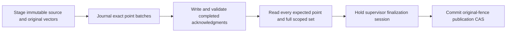

# Native Qdrant stage and publish

The optional Python module `cragkit.qdrant_publication` and Node subpath `cragkit/qdrant-publication` provide the managed stage/publish path. [Acceptance evidence](../evaluation/reports/V5/V5-04F2a2ii.md) records the exact native tests. Repair, security convergence, purge and the worker-process profile remain separate V5 tasks; this module does not yet establish full QD-r1 compatibility.

For example, G1 remains active while G2 is staged, written and verified. Only the final SQL commit switches the active generation to G2. If that work fails first, G1 remains active.



## Dependencies and ownership

Applications supply two opened optional PostgreSQL resources: a restricted writer resource and a restricted supervisor resource. Install the declared authority schema explicitly. The application also initializes the supported native Qdrant supervisor with its owned binary, storage and registered profile. Manager construction and imports do not open resources, apply migrations, install models or start servers.

Construct a writer, its exact reconciliation verifier and recovery coordinator, then bind them in `PostgresQdrantPublicationAuthority(writer, recovery)`. Construct `ManagedQdrantPublicationTransport(supervisor)` with that same actual supervisor. Pass those objects, the complete QC-r1 configuration and your application's write authorizer to the five-argument manager.

The manager checks original dependency identities. Equivalent configuration does not make another verifier the issuer of a recovery receipt. The public module reexports native dependency classes for explicit construction; private receipt and proof accessors are not public API.

Given already opened resources, an initialized supervisor and the complete configuration:

```python
from cragkit.qdrant_publication import (
    ManagedQdrantPublicationTransport, PostgresQdrantPublicationAuthority,
    PostgresQdrantRecovery, PostgresQdrantWriter,
    QdrantPublicationManager, QdrantReconciliationVerifier,
)

writer = PostgresQdrantWriter(writer_resource, config, instance_id)
verifier = QdrantReconciliationVerifier(writer, supervisor)
recovery = PostgresQdrantRecovery(supervisor_resource, config, supervisor, verifier)
authority = PostgresQdrantPublicationAuthority(writer, recovery)
transport = ManagedQdrantPublicationTransport(supervisor)
manager = QdrantPublicationManager(authority, transport, config, supervisor, authorize_write)
await manager.initialize(deadline=deadline)

staged = await manager.stage(change, scope, stage_ledger, deadline=deadline)
published = await manager.publish(
    {"collection": collection, "document_id": document_id, "intent_id": intent_id},
    scope, publish_ledger, deadline=deadline,
)
await manager.close()
```

Node exposes the same classes and constructor order. Its methods take a final `{deadline, signal?}` options object. Python uses native task cancellation. Use the existing [optional PostgreSQL resource API](development.md) and [QW-r1 input specification](../contracts/QDRANT_PUBLICATION_V5.md) for complete configuration and stage shapes.

The application closes the borrowed transport, recovery coordinator, writer, resources and controller after managers finish. Manager close drains its operations and handles; it does not close those borrowed dependencies. The reconciliation verifier's own cleanup interface follows its runtime implementation.

## Input, authorization and budgets

Stage input includes the complete immutable source, revision, generation, manifest, original vectors and explicit initial authorization. Fake-profile arrays support routine synthetic tests. Real embedding profiles require already-computed bound E-r1 batches. The manager makes no embedding/model call.

Publish takes exactly `collection`, `document_id` and `intent_id`. Tenant identity comes from the separately supplied trusted scope. Caller input cannot provide an owner capability. The asynchronous authorizer receives that scope and target and must return a real boolean. It runs before admission, each new mutation and final publication, outside SQL transactions; current SQL fences remain authoritative afterward.

Each operation reserves at most one logical ledger attempt and charges zero model calls and candidates. Reusing an exhausted ledger cannot send a write. The supplied deadline and ledger deadline share the same operation budget. The manager admits one operation at a time without a queue.

## Outcomes and retries

Results have nine fields: `intent_id`, `operation`, `state`, `revision_id`, `generation_id`, `authority_committed`, `replica_complete`, `published` and `purge_complete`. Staged immutable records are durable while the publication flags remain false. A matching completed retry returns its historical outcome; it does not restore old authorization or make its generation current again.

A same-epoch prepared retry retains the recorded owner and selected settled dispatch binding, performs fresh full readback and requires the same deterministic witness digest. It sends no replacement upsert and does not replace the immutable preparation. Fresh locked admission still rejects unresolved work or changed original fences before publication.

A completed HTTP acknowledgment and SQL settlement are separate. If SQL's response is lost after a completed write, the manager reconciles the same durable identity and acknowledgment hash. If the HTTP acknowledgment itself is lost, the journal remains unresolved and a retry cannot resend it. Managed repair is required before a successor can proceed; readback alone cannot settle that uncertainty.

The final supervisor session excludes raw lifecycle changes and competing recovery while fresh authorization, verification and SQL finalization unwind. Callbacks remain outside SQL. If a callback suppresses cancellation, cancellation stays latched: it cannot later continue into publication, and new work remains refused while unfinished work drains.

A preparation tied to a retired epoch needs the planned additive attestation repair path. It cannot be made current by changing its hash, owner, generation or intent in place. See the [tracker](../tasks/todo.md) for remaining V5 work.
