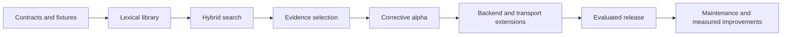

# Cragkit implementation and learning plan

Plan baseline 1 | 19 October 2026 | Implementation and verification state tracked in [todo.md](todo.md)

## 1. Purpose and governing decisions

Cragkit will reduce repeated retrieval integration work through installable Python and TypeScript libraries. It will retrieve source-linked evidence, enforce resource and access constraints, and report incomplete evidence clearly. Final answers remain the consuming application's responsibility. Reduced integration effort and improved retrieval quality must be measured; neither a line-count saving nor zero hallucinations is an established result.

The [BRD](../docs/product/BRD.md) defines the intended users, business outcomes and requirement IDs. It does not replace version acceptance criteria or the tracker. The governing design is [ARCHITECTURE.md](../docs/architecture/ARCHITECTURE.md), with its [diagram catalog](../docs/architecture/DIAGRAMS.md). This plan decomposes that design. Later user decisions add a small-machine development constraint and retain Python/TypeScript with Pydantic/Zod. Rust is not part of this baseline. The original Gemini document and early review are historical inputs where they disagree with the later architecture.

Keep these boundaries throughout implementation:

- Python and TypeScript execute natively in their respective application processes. The npm package does not require a Python service.
- PostgreSQL is the first reference backend. Native FTS is labelled accurately; it is not BM25.
- Core code stays independent of frameworks, model runtimes, and transport hosts. Integrations are optional.
- Trusted scope is resolved by the application and cannot be changed by a query planner or agent tool input.
- Evidence text is an exact span from an immutable canonical revision. Source fidelity, relevance, sufficiency, and answer support are different properties.
- Bounded orchestration surrounds optional, nondeterministic model calls. No universal score threshold is assumed.
- Retrieval results estimate sufficiency. They do not certify source truth or promise that a parent LLM will obey them.

## 2. How to use these documents

Read this plan once, then work from the active version document. [todo.md](todo.md) is the only implementation checkbox tracker. Version documents contain task definitions; [EDGE_CASES.md](EDGE_CASES.md) contains the validation inventory. Do not duplicate completion state in three places.

Every task has an ID, dependency, expected files, a small scope, acceptance evidence, and a learning exercise. A task may be divided into child tasks in the tracker if it proves larger than one focused session. Keep its parent incomplete until all children pass. Future version details should be refined immediately before starting that version, using findings from earlier work while preserving architecture boundaries.

The user is learning while building. At the start of a task, explain the concept with one example and invite a choice between guided implementation and assisted implementation. Do not make every task wait for a quiz. At the end, demonstrate the behavior, explain the test, and offer one small variation the user can implement. Record learning as demonstrated, practiced, or pending; avoid claiming understanding just because code passes.

## 3. Versions and phase mapping

Version labels below are learning/build milestones, not SemVer major releases. The artifact labels are tentative and must be checked against package registries before publishing. Each milestone can be built locally; publishing is a separate action with its own release checklist.

| Milestone | Deliverable | Architecture phase | Tentative artifact label | Plan |
| --- | --- | --- | --- | --- |
| V0 | Workspace, shared contracts, tiny corpus and resource baseline | 0 | Internal only | [V0](versions/V0-foundations.md) |
| V1 | Source-linked lexical retrieval in both runtimes | 1 | 0.1.0-alpha.1 | [V1](versions/V1-first-library.md) |
| V2 | Embedding profiles, vector search, hybrid fusion | 2 | 0.2.0-alpha.1 | [V2](versions/V2-hybrid-search.md) |
| V3 | Reranking, facet estimates and exact context packing | 3 | 0.3.0-alpha.1 | [V3](versions/V3-evidence-quality.md) |
| V4 | Bounded correction, diagnostics and first framework adapters | 4 and 5 | 0.4.0-alpha.1 | [V4](versions/V4-corrective-alpha.md) |
| V5 | Qdrant, existing indexes and optional MCP | 6 | 0.5.0-beta.1 | [V5](versions/V5-integrations.md) |
| V6 | Evaluated release, distribution, migration and maintenance workflow | 7 | 1.0.0-rc.1, then 1.0.0 | [V6](versions/V6-release.md) |

No fixed delivery dates are assigned. Move by demonstrated behavior and manageable sessions. The first useful library is V1. The complete corrective alpha is V4. V5 completes the planned alternative-backend and transport scope before the full V6 release.

## 4. Development resource policy

Use the previously inspected M4/16 GB machine as the development constraint, not a measured runtime guarantee. Recheck available disk and memory before installs or large evaluations. These are conservative starting settings, to be adjusted from observations:

| Workload | Starting policy |
| --- | --- |
| Routine unit/contract work | One test process; fake providers; no running database unless the task needs it. |
| Database integration work | Hosted Supabase development PostgreSQL, one language suite at a time, and isolated test data. Local PostgreSQL/Docker is optional. |
| Fixture corpus | Start with 10-20 short documents and about 30 reviewed questions; expand only for a stated test need. |
| Ingestion | One active job, streaming input, small bounded batches; cap both bytes and tokens, not only item count. |
| Provider work | Fake providers by default. Explicit live runs with at most two in-flight requests initially and a configured spend limit. |
| Local model work | Optional; one selected model/session at a time after checking asset size and license. No automatic downloads. |
| Watchers | Only the package being edited; run full cross-language conformance at checkpoints. |
| Cross-platform builds | Prefer CI once configured; local installation tests use the current platform. |
| Other backends | Run Qdrant only for its active integration task; test one backend profile at a time where possible. |

The user has authorized parallel agent lanes for independent, plan-aligned Cragkit work. Apply the project [coordinate](../.agents/skills/cragkit-coordinate/SKILL.md) and [manager](../.agents/skills/cragkit-manager/SKILL.md) skills through [the coordination protocol](../docs/agents/WORKFLOW.md) whenever coordinating or managing agents. Use one writer when work is dependent or indivisible. Parallel peers need separate writable paths and a named assembler; shared contracts, migrations, manifests, lockfiles and the tracker each retain one owner. Keep one local test process and serialize language integration suites. Delegation does not satisfy task dependencies or expand scope, services, provider disclosure or spending permissions.

If memory pressure rises, swap grows persistently, or the editor becomes unresponsive, stop the active benchmark, record the workload, and reduce batch size or concurrency before retrying. Do not solve this by silently switching providers, dropping correctness checks, or deleting unrelated files. Cache cleanup must be scoped to known generated project artifacts. Avoid repeated large downloads by recording model/cache locations.

The accepted development database choice is hosted Supabase to reduce laptop storage and memory use. Use the standard PostgreSQL adapter; Supabase-specific application services are optional. Routine unit tests remain local with fixtures and fake providers. Plan disposable PostgreSQL integration checks in CI when configured. Before hosted tests, verify the dedicated development target, connection mode, privileges, schema isolation and extension versions. The user-created development project, hosted administrative checks and successful authenticated native verification are recorded in the development guide. Environment configuration alone does not complete V1.

Measure package and transitive dependency size, cold import time, peak process memory, database footprint, and end-to-end latency separately. For hosted runs, label database/network latency separately from local library processing and do not report remote database memory as laptop memory. OS memory pressure and responsiveness complement process measurements. Do not add per-process peak RSS values and call the sum an exact simultaneous system peak.

Numeric release budgets will be proposed from V0/V1 baselines and frozen before release evaluation. The architectural retrieval preset is an experiment, not a reason to use its maximum fan-out during every local test. Limits below that preset may be used for development without changing semantic contracts.

## 5. Learning workflow

Use [LEARNING.md](LEARNING.md) as a lightweight journal template. A suggested session is 10 minutes of explanation, 30-60 minutes of one implementation slice, and 10-15 minutes of verification and notes. These are adjustable study blocks, not delivery estimates.

For each concept: predict a result, run it, explain a mismatch, and change one input. Learn asynchronous programming through cancellation tests, database transactions through interrupted ingestion, ranking through tiny hand-calculated lists, and evaluation through labelled questions. Avoid studying an entire framework before the current task needs it.

At checkpoints, demonstrate the current library and discuss one design decision with the user. Routine checkpoints do not require a new permission request. If the next task depends on an unresolved product, credential, cost, or data-disclosure choice, prepare the alternatives and ask only for that decision. A user request to continue implementation is authorization to perform routine plan-aligned local work.

## 6. Task completion and evidence

A task is complete when its acceptance criteria are met, relevant behavior has been exercised, meaningful edge cases pass, and public behavior is documented. Run focused tests first. Run broader regression and cross-language conformance at the version checkpoint. Tests should demonstrate behavior and failure handling, not repeat implementation lines.

For every completed task, add an evidence path or command/result summary in the tracker. If a test requires a service or provider that was not run, record it as unvalidated. Do not mark the task complete solely because code compiles. Documentation-only tasks need a consistency/link review, not artificial code tests.

Suggested evidence location once implementation begins: `evaluation/reports/<milestone>/<task-id>.md`. Include configuration, fixture/corpus revision, relevant model/profile identity, command, result, limitations, and resource observations. Avoid storing source secrets or private query content in reports.

V0 defines and records the actual commands for focused Python tests, TypeScript tests/typecheck, shared fixtures, database tests and package builds in [development.md](../docs/development.md). Use the commands already verified there; later commands remain pending until their owning task establishes them. Task instructions refer to commands by purpose instead of inventing scripts or successful runs.

## 7. Architecture coverage

| Architecture section | Owning milestone(s) | Validation focus |
| --- | --- | --- |
| 1-2: purpose and decisions | V0, V6 | Scope checklist and real developer trials |
| 3-4: deployment and modules | V0, V1, V4, V5 | Import isolation, optional dependencies, native execution |
| 5: API contracts | V0, every version | Shared valid/invalid fixtures and stable error semantics |
| 6: ingestion lifecycle | V1, V2, V5 | Byte spans, publication, concurrent updates, deletion, reindex |
| 7: storage and connections | V1, V2, V5 | Scope, pooling, timeouts, capabilities, backend consistency |
| 8: state machine | V2-V4 | Fusion, grading, bounded correction and accounting |
| 9: evidence integrity | V1, V3, V6 | Exact source match, partial evidence, calibrated claims |
| 10: context accounting | V3, V4 | Tokenizer/renderer identity and final tool envelope |
| 11: failure/privacy controls | V1-V6 | Cancellation, invalid providers, revocations, redacted traces |
| 12: language parity | Every version | Shared golden cases and real shared-database tests |
| 13: validation | V0, V2-V6 | Baselines, held-out evaluation, resource and usability evidence |
| 14-16: phases and open choices | This plan, V0, V6 | Explicit decision records, package/version checks |

## 8. Edge cases and evaluation strategy

[EDGE_CASES.md](EDGE_CASES.md) is the initial architecture-derived inventory. It is not a claim that every possible failure is known. Add a regression case whenever implementation, review, or a developer trial finds a new failure. Each listed case has an owning task and expected outcome.

Use three test layers: deterministic unit/contract fixtures, real database/adapter integration, and explicit live-model evaluation. A fake model can prove cancellation or score handling; it cannot prove real retrieval quality. Real evaluations must compare lexical, dense, hybrid, reranked hybrid, and corrective modes on the same questions and corpus revision.

Separate development and held-out questions by document family where feasible. Include missing answers and multi-facet questions from the start. Add enough reviewed questions for useful statistical estimates before public quality claims; report sample sizes and uncertainty. Calibrate on development data and freeze targets before the held-out run. If targets fail, revise the candidate on development data; do not repeatedly tune to the same held-out answers.

Authorization, citation fidelity, and bounded execution require zero observed violations in the defined test suite. Quality thresholds such as recall and false-sufficient rate depend on measured baselines and application needs. Record formulas and denominators; do not manufacture a universal target.

## 9. Packaging, deployment and publication

A library release primarily produces Python wheel/sdist and npm tarballs. Database migrations are explicit caller actions. A hosted service is not required to use the packages. MCP deployment is documented separately in V5, and any demo deployment remains an optional example.

Build and install local artifacts before registry publication. Test default imports with networking disabled and heavy optional integrations absent. Test adapter installation separately. Verify metadata, included files, dependency bounds, licenses, supported platforms, and example behavior. Keep build artifacts free of credentials and accidental model assets.

Public publication, external deployment, and paid live evaluations require authorization appropriate to their actual action. Prepare artifacts and reviewable evidence first; this planning request itself does not publish anything. Once authorized, use the configured release workflow. A package release cannot be fixed by pretending an old artifact changed: prepare a corrective version and document migration/rollback.

## 10. Decision backlog and risk controls

| Decision/risk | Resolve by | Small next step |
| --- | --- | --- |
| Runtime and dependency compatibility | V0-03 | Probe minimal Pydantic/Zod, drivers and test tooling; pin only tested combinations. |
| Embedding choice and dimensions | V2-01 | Compare one modest local option and one allowed API option on a small development subset. |
| Reranker and coverage assessment | V3-01 / V3-05 | Record score semantics and human-labelled facet examples; preserve unknown. |
| Tokenizer support | V3-03 | Select one explicit tokenizer/renderer pair and verify byte/token boundaries. |
| Two engines drift | Every checkpoint | One fixture specification; implement in one runtime, then the other before closing the milestone. |
| Excessive scope | Every milestone | Split tasks, defer optional research, keep the current demo runnable. |
| Alternative-store consistency | V5-01 | Specify publication and ACL authority before implementing Qdrant queries. |
| Package names/license/provider costs | V0, V6 | Keep identifiers provisional; resolve before external distribution or usage. |
| Insufficient resource headroom | V0 and checkpoints | Measure first; shrink workload and serialize tests. |

Record consequential choices under `docs/decisions/` during implementation. If a choice would change the architecture, document the conflict and resolve it with the user instead of silently modifying scope.

## 11. Completion boundary and maintenance

The initial project is complete when V6's supported scope passes its release gates, both installable artifacts work in clean environments, limitations and benchmark evidence are published with the release, and maintenance ownership is documented. Publication and local release readiness remain separately tracked.

After release: reproduce bugs with minimal cases, add regressions, release fixes, review dependency/security updates, and rerun quality checks when models, ranking policies, or tokenizers change. Do not turn every dependency update into a full redesign.

PDF/OCR, dependent multi-hop retrieval, answer verification, and a hosted telemetry UI remain later research from the architecture. Before starting one, create a scoped proposal with a user need, resource estimate, contract impact, and evaluation gate. They are not prerequisites for completing this project.

## 12. Selecting the next action

Read the current handoff in [todo.md](todo.md), then select the smallest task whose dependencies are satisfied. V0-01 is the starting point for a new implementation, not an instruction to repeat completed work. Each session should end with a small verified artifact, recorded limitations and a clear next task.
